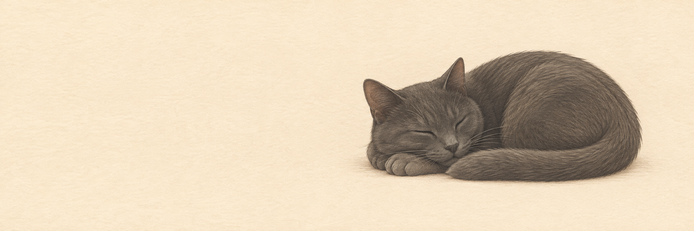

# Tommy Mathisen

I build tools for Linux, automation, and AI-assisted workflows. I focus on making complex systems easier to work with, reducing repetitive tasks, and keeping software understandable and maintainable.

## Technologies

Go · Python · TypeScript · Linux · Docker · GitHub Actions

## Live sites

- [mathizen.net](https://mathizen.net)
- [Pushify](https://pushify.me)
- [Botbin](https://botbin.net)
- [Dirty Dyk](https://dirtydyk.com)
- [Nyheter](https://nyheter.mathizen.net)
- [Buss.ax](https://buss.ax)
